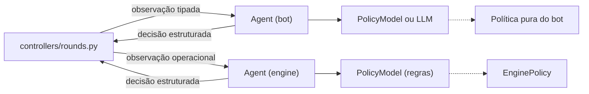

# ADR-002: Agno como harness dos dois agentes

## Status

Aceita — 18/11/2026

## Contexto

O `Enunciado.md` exige **dois agentes com objetivos conflitantes, ações e regras de decisão explícitas**, e que a
implementação siga os conceitos e práticas da aula — que usa **Agno** como harness (agente, ferramentas, hooks,
logging). O `AGENTS.md` reforça: "Use Agno for the agent layer".

Ao mesmo tempo, o §6.1 do Trabalho 1 afirma que "os agentes são funções ou classes baseadas em regras, **sem modelos de
IA**", e o `AGENTS.md` original proíbe "external services or hidden model calls".

O grupo decidiu que o Agno será usado de verdade na camada de agentes, e que um **LLM externo** atuará como **bot
atacante** na validação adversarial (ADR-003). Isso torna necessário separar o que é harness (Agno) do que é decisão
(política) e do que é estado (simulador).

## Decisão

1. **Os dois lados são `agno.agent.Agent`**: `agents/bot.py` e `agents/engine.py`, cada um com `tools` escopadas,
   `instructions` e hooks.
2. **Motor antifraude:** usa um **modelo determinístico** (`PolicyModel`), subclasse de `agno.models.base.Model`, que
   traduz a observação operacional em uma decisão da política pura (`EnginePolicy`). Sem rede.
3. **Bot caçador de cupons:** usa o **mesmo adaptador determinístico** no modo padrão e um **modelo externo**
   (Claude/Groq) no modo `adversarial_validation` (ADR-003).
4. **O estado de domínio pertence ao simulador**, não ao Agno. Cada `agent.run(...)` é uma decisão de turno único:
   recebe uma observação tipada e devolve uma decisão estruturada. Não usamos memória/sessão do Agno como fonte de
   verdade.
5. **Ferramentas são a fronteira de capacidade.** O bot só recebe ferramentas de ações legais do atacante; o motor só
   recebe ferramentas de consulta a sinais operacionais e de decisão. Um agente não consegue executar o que não tem
   ferramenta para executar.
6. **Hooks** são usados para validar/redigir a entrada e registrar a execução (`pre_hooks`/`post_hooks`), como defesa em
   profundidade da separação de informação (ADR-006).
7. **Sem `Team` e sem `AgentOS`** no caminho avaliado. O simulador é um processo local; a orquestração é do
   `controllers/rounds.py` (ADR-004).

## Consequências

### Positivas

- O Agno é usado como harness real: loop de ferramentas, hooks, instruções e logging da aula.
- As regras continuam explícitas e testáveis fora do framework; o adaptador é a única peça acoplada ao Agno.
- A separação de informação ganha uma camada estrutural (ferramentas escopadas + hooks), não apenas convenção.
- O motor determinístico preserva os testes de borda e a auditoria da defesa.

### Negativas

- Exige implementar a interface `Model` do Agno (métodos de invocação/streaming e parsing), com risco concentrado no
  adaptador.
- Acopla o projeto à API do Agno 3.1.7; atualizações exigem revalidar o adaptador.
- Uma chamada de agente por tentativa pode ter overhead; o desenho prevê lote quando necessário.

### Neutras

- O `AGENTS.md` original precisa ser atualizado: a proibição de chamadas externas deixa de valer para o modo opcional de
  validação adversarial.
- O §6.1 do Trabalho 1 é interpretado como "decisões explícitas", não como "proibição de harness".

## Alternativas consideradas

- **Classes Python puras, sem Agno:** rejeitado. Não atende ao `AGENTS.md` nem à prática da aula.
- **LLM para os dois agentes:** rejeitado. Torna o motor não determinístico, inviabiliza os testes de borda
  (R$ 30,00 × R$ 30,01) e enfraquece a separação de informação.
- **Agno apenas como `Workflow`/orquestração, com regras em steps:** rejeitado pelo grupo; a camada de agentes ficaria
  decorativa.
- **`Team` com líder LLM roteando os dois lados:** rejeitado. Adiciona não determinismo e custo sem benefício para o
  escopo.

## Referências

- `docs/Enunciado.md`, requisitos 2 e 3.
- `docs/Trabalho1.md`, §6.1 e §6.2.
- `docs/Aula 10+11+12.pdf`, seções 2 (agentes), 3.1 (ferramentas) e 3.4 (hooks).
- ADR-003 (LLM adversário), ADR-006 (separação de informação), ADR-010 (MVC simples).
