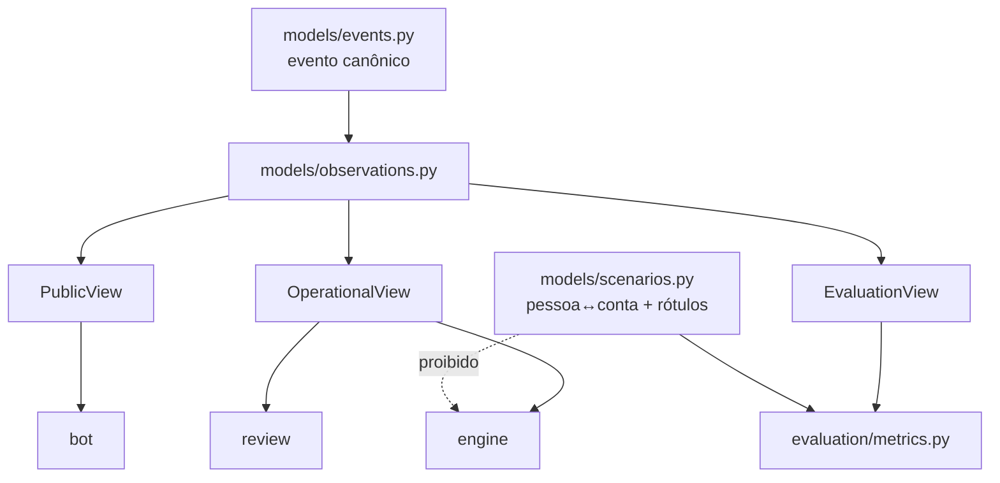

# ADR-006: Separação de informação por projeções e ferramentas escopadas

## Status

Aceita — 18/11/2026

## Contexto

O `AGENTS.md` impõe uma regra dura: **`agents/` e `models/checkout.py` nunca importam `evaluation/`**. Nenhum rótulo (
"fraudulento"/"legítimo") nem o mapa pessoa↔conta pode chegar ao motor ou à revisão. O bot vê apenas suas próprias
ações, recursos e respostas públicas. O avaliador é o único que enxerga tudo.

O §6.1 do Trabalho 1 reforça: o motor não recebe o rótulo nem a identidade sintética; a ligação fica em estrutura
separada, acessível ao gerador e ao avaliador.

Convenção sozinha não garante isso: um import acidental ou um campo a mais no dicionário de observação vaza informação.

## Decisão

1. O `models/events.py` registra eventos canônicos; `models/observations.py` define as **três projeções**:
    - `PublicView` — para o bot: resultado público, mensagem pública, verificação pedida, estado da conta do próprio
      bot.
    - `OperationalView` — para o motor e a revisão: sinais apresentados, histórico operacional, resultados de revisão.
      Sem rótulos, sem estratégia/custo do bot.
    - `EvaluationView` — para `evaluation/metrics.py`: tudo, incluindo rótulos e o mapa pessoa↔conta.
2. As observações entregues aos agentes são **DTOs tipados**, montados por funções de *whitelist*. Nada de `dict` cru
   com o estado inteiro.
3. As **ferramentas** de cada agente são escopadas: o bot não tem ferramenta para consultar CPF/telefone de terceiros
   nem para ler a política do motor; o motor não tem ferramenta para ler a tática ou o custo do bot.
4. O `models/scenarios.py` é o único módulo de domínio que conhece o mapa pessoa↔conta e os rótulos; `evaluation/` é o
   único consumidor.
5. O motivo interno da decisão fica separado do resultado público: `coupon_decided` guarda os dois, mas a projeção
   pública expõe só o resultado e a mensagem genérica.
6. Um **teste de importação** em `tests/test_separation.py` percorre a AST de `src/agents/*.py` e de
   `src/models/checkout.py` e falha se houver import de `evaluation`. Um segundo teste verifica que os DTOs
   públicos não têm campos proibidos.
7. Hooks do Agno (`pre_hooks`) validam a observação antes da decisão e registram a execução; são defesa em profundidade,
   não a única barreira.

## Consequências

### Positivas

- A separação deixa de depender de disciplina: import proibido quebra o teste; campo extra quebra o teste de DTO.
- O motor decide com a informação que teria em produção, o que dá validade à simulação.
- O avaliador consegue medir falsos positivos e negativos sem contaminar os agentes.

### Negativas

- Mais código de mapeamento (evento → três projeções) e risco de divergência entre projeções.
- O teste de importação por AST precisa ser mantido se a estrutura de pastas mudar.
- A projeção pública pode ser pobre demais e limitar a adaptação do bot; o equilíbrio exige revisão.

### Neutras

- O evento canônico é a fonte única; as projeções são visões, não cópias independentes.
- O `internal_reason` continua registrado para auditoria e para o avaliador.

## Alternativas consideradas

- **Apenas convenção/documentação:** rejeitado. Já existe a regra escrita e ela não impede um import acidental.
- **Processos separados com troca de mensagens:** rejeitado. Over-engineering para um protótipo local.
- **Views de banco de dados:** rejeitado. Não há banco (ADR-005).
- **Passar o estado inteiro e "confiar" nos agentes:** rejeitado. Contraria a regra dura e invalidaria a avaliação.

## Referências

- `AGENTS.md` (regra de dependência e separação de informação).
- `docs/Trabalho1.md`, §4.5, §5.2 e §6.1.
- `docs/Enunciado.md`, requisito 5 (evidências).
- ADR-002 (ferramentas escopadas), ADR-009 (testes), ADR-010 (MVC simples).
