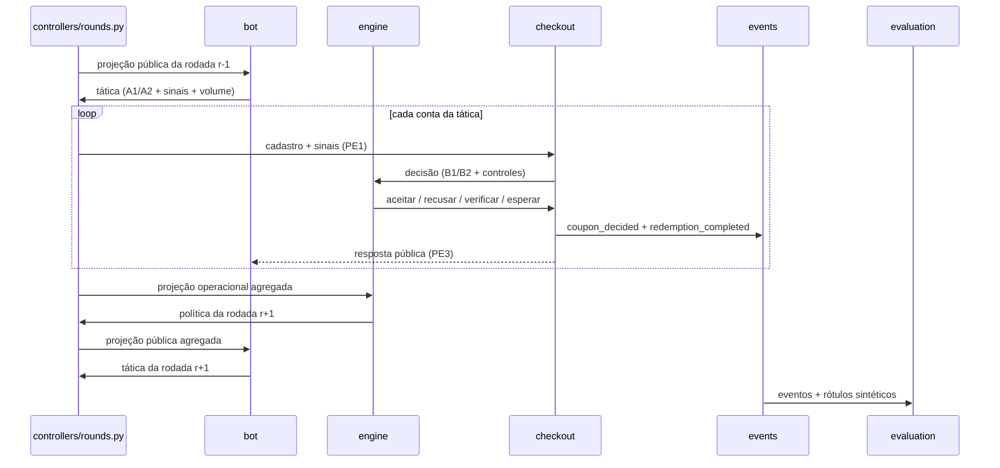

# ADR-011: Iteração adversarial — protocolo da rodada, observação e adaptação

## Status

Aceita — 18/11/2026 — atualizada em 20/11/2026: cenário de referência com 5–6 rodadas, vocabulário público de respostas
e gatilho de recuo por ROI (ADR-012).

## Contexto

O `Enunciado.md` exige pelo menos **três rodadas conectadas**, o ciclo **ação → resposta → observação → adaptação** e
evidências de que o comportamento muda por causa das rodadas anteriores. Ele também rejeita três ações independentes ou
uma sequência previamente roteirizada.

O Trabalho 1 já definiu o conteúdo das rodadas (§3: **AM1 → AM2 → AM3**), os eventos observáveis (§6.3) e os dois modos
de demonstração (§6.1: guiado e adaptativo). Falta consolidar **como o simulador executa esse ciclo**: quem decide o
quê, em que ordem, com que informação, o que dispara a adaptação e o que fica registrado.

O recorte é um **protótipo**, não uma plataforma de produção. O protocolo precisa ser o menor possível que ainda
demonstre a interação e a adaptação com evidência auditável.

## Decisão

1. **Unidade de tempo.** Uma rodada representa **7 dias simulados** (configurável) e é executada por
   `controllers/rounds.py`. O laço é `1..N`, com **N ≥ 3**. O **cenário de referência** da demonstração usa **6
   rodadas**
   e a suíte padrão usa 3, por custo de execução; `N` é configuração (`rounds`), nunca um roteiro.
2. **Protocolo da rodada.** Para cada rodada `r`:

    1. o bot recebe a **projeção pública** da rodada anterior (aceitação, recusas, verificações pedidas, limites, custo
       próprio);
    2. o bot escolhe **uma tática** do catálogo fechado (A1/A2, fonte dos sinais, volume e padrão de sondagem), por
       regra no modo determinístico ou pelo LLM no modo `adversarial_validation` (ADR-003);
    3. o executor aplica a tática: para cada conta planejada, cadastro (PE1) → decisão do motor → checkout (PE2) →
       resposta pública (PE3) → evento; a mesma rodada executa uma **coorte de clientes legítimos** (incluindo
       compartilhamento de endereço/dispositivo, **P3**), que passa pelo mesmo checkout e alimenta conversão, falsos
       positivos e comissão;
    4. o motor recebe a **projeção operacional agregada** da rodada (volume, sinais repetidos, relações, limites,
       contestações, orçamento);
    5. ao final, cada lado adapta sua política **para a rodada seguinte**, usando apenas o que enxerga; a mudança é
       registrada com o gatilho que a disparou;
    6. as métricas da rodada são fechadas pelo avaliador.

3. **Uma decisão por rodada, não por conta.** O bot escolhe a tática no início da rodada; o executor a aplica de forma
   determinística. Isso mantém o custo do LLM baixo e a adaptação no nível que o trabalho avalia. O bot vê as respostas
   durante a rodada, mas só muda a tática na rodada seguinte.
4. **O que o bot vê:** seus próprios recursos e custos, o resultado público de cada tentativa (aceito, recusado,
   verificação pedida, limite/espera) e a mensagem pública. **Não vê** rótulos, o mapa pessoa↔conta, as regras internas
   do motor, o orçamento da plataforma nem os custos da defesa. O resultado público é um **vocabulário fechado** —
   `accepted`, `coupon_already_used`, `verification_required`, `rate_limited` — e o texto exibido pode ser detalhado
   antes
   do redesenho da AM3 e genérico depois, sem mudar o vocabulário.
5. **O que o motor vê:** sinais apresentados, histórico, relações entre contas, limites acionados, contestações e
   métricas agregadas. **Não vê** rótulos, a tática ou o custo do bot, nem a identidade do controlador.
6. **Estado entre rodadas.** Contas, sinais já usados, janelas de limite, políticas e orçamento persistem. Uma conta que
   concluiu a primeira compra **nunca** volta a ser elegível.
7. **Gatilhos de adaptação.** São configuráveis e avaliados ao final da rodada. Os valores abaixo são **defaults
   iniciais**, não limiares calibrados:

   | Lado | Observação | Condição inicial | Adaptação esperada |
      |-------|----------------------|------------------------------------------------------|-------------------------------------------------|
   | Bot | aceitação | taxa < 50% | trocar a fonte dos sinais (e-mail → SMS/CPF/emulador) |
   | Bot | verificação | SMS/CPF pedido em > 30% das tentativas | comprar sinais ou mudar a tática |
   | Bot | mensagem | recusa com motivo detalhado | sondar um sinal por vez (AM3) |
   | Bot | limite/espera | bloqueio em > 10% das tentativas | distribuir tentativas e trocar vários sinais |
   | Bot | custo | custo por conta aprovada ≥ R$ 20 (ADR-012) | recuar para A1 e pausar a escala |
   | Bot | orçamento de ataque | gasto ≥ teto de `budget.attack` | pausar e reduzir o volume |
   | Motor | cadastros | volume > 2× a linha de base ou > 100/rodada | B1 → B2 |
   | Motor | sinais | > 20% das contas compartilham dispositivo/CPF | exigir verificação ou recusar a relação |
   | Motor | resgates | > 50% sem segunda compra | revisar elegibilidade |
   | Motor | sondagem | ≥ 3 tentativas com apenas um sinal alterado | mensagem genérica + limite + detecção |
   | Motor | contestação | > 5 contestações ou > 20% de reversões | revisar a regra que originou a recusa |
   | Motor | orçamento | > 20% do orçamento mensal | alerta e análise das combinações suspeitas |

8. **Modos.** O **adaptativo** é o padrão e a evidência principal: nenhuma mudança é garantida, só ocorre se o gatilho
   disparar. O **guiado** usa um `Script` que força os gatilhos da sequência AM1 → AM2 → AM3 nas rodadas 1–3 e marca
   cada mudança como `programada`; ele usa o mesmo protocolo, o mesmo checkout e as mesmas regras — não é um caminho de
   código separado. A trajetória de 5–6 rodadas da tabela abaixo é **hipótese do cenário de referência**, não sequência
   programada: se um gatilho não disparar, a execução termina antes, e a ausência da mudança também é evidência.
9. **Evidência por rodada.** O simulador grava, no mínimo: tática do bot, política do motor, contas tentadas, aceitas,
   recusadas e verificadas, resgates, orçamento consumido, custo do bot, falsos positivos/negativos (só no avaliador),
   conversão, gatilhos acionados e mudanças aplicadas. A UI mostra a **cadeia causal** ("motor mudou X porque observou
   Y; bot mudou Z porque observou W").
10. **Escopo do protótipo.** Ficam deliberadamente de fora:
    - mais de uma tática por rodada e adaptação intra-rodada;
    - CPF, SMS, dispositivo e cartão reais — são identificadores sintéticos;
    - análise de grafo ou modelo de anomalia — as relações são comparações diretas de sinais;
    - todos os eventos do §6.3 — só os que sustentam o ciclo e as métricas da seção 5.5;
    - pagamento, entrega, outros cupons e ataques à infraestrutura (já fora da Ficha).

## Rodadas de referência

| Rodada                | Bot                                                        | Motor                                                                | O que dispara a próxima                                                           | Evidência principal                                            |
|-----------------------|------------------------------------------------------------|----------------------------------------------------------------------|-----------------------------------------------------------------------------------|----------------------------------------------------------------|
| 1 (AM1 / P1)          | A2 com e-mails descartáveis, ~200 contas, c ≈ R$ 0         | B1, mensagem detalhada                                               | motor: pico de cadastros → B2; bot: aceitação alta → mantém e aumenta             | ~200 resgates, R$ 4.000, 100% de aceitação                     |
| 2 (AM2 / P2)          | A2 com SMS virtual, CPF vazado e emulador, c ≈ R$ 5        | B2, mensagem detalhada                                               | bot: recusa → sondagem; motor: relações + mensagem genérica + limite              | aceitação cai, custo sobe, conversão 70% → 55%                 |
| 3 (AM3 / P3)          | Sondagem de um sinal por vez, c ≈ R$ 8                     | B2 + os quatro controles da AM3                                      | bot: mensagem genérica → troca vários sinais; motor: ajusta limiares              | mais tentativas, menos resgates, falsos positivos em P3        |
| 4 (contra-adaptação)  | Troca vários sinais por tentativa, volume maior, c ≈ R$ 12 | B2 com mensagem genérica, limite, detecção de sondagem e contestação | bot: custo por aprovada sobe → avalia ROI; motor: contestações e falsos positivos | poucas aceitações, mais tentativas por aceite, contestações    |
| 5 (limite econômico)  | Recua para A1 e pausa quando o custo por aprovada ≥ R$ 20  | Suaviza limiares e revê regras de endereço para recuperar conversão  | bot: ROI negativo encerra a tática; motor: recupera conversão sem reabrir B1      | `cost_per_approved`, queda de resgates, conversão de legítimos |
| 6 (patamar, opcional) | A1 com tentativa residual                                  | B2 calibrado + contestação                                           | nenhum gatilho dispara; ambos estabilizam                                         | orçamento residual e taxa de falsos positivos                  |

As rodadas 1 e 2 correspondem a **(A2, B1)** e **(A2, B2)** da matriz estática; da rodada 3 em diante o bot **sonda** as
regras e o motor responde com o redesenho da seção 5 do Trabalho 1. É essa diferença que o modelo dinâmico acrescenta.
As
rodadas 4–6 vêm do Plano de Tarefas do Grupo 9 e só existem se os gatilhos das rodadas anteriores dispararem; os valores
de custo e o limiar de recuo estão na ADR-012.

## Diagrama de uma rodada

## Consequências

### Positivas

- Atende diretamente aos requisitos 3, 4 e 5 do Enunciado, com uma cadeia causal explícita por rodada.
- O modo adaptativo não é roteirizado: a mudança só acontece se o gatilho configurado disparar.
- O protocolo é simples o suficiente para testar: uma rodada é uma função determinística do estado + tática + política.
- O custo do LLM fica em uma chamada por rodada, e o motor continua auditável.
- O vocabulário público fechado permite trocar mensagem detalhada por genérica sem mudar o contrato com o bot, que é a
  essência do redesenho da AM3.
- O recuo por ROI (ADR-012) transforma o limite econômico em gatilho auditável, não em narrativa.

### Negativas

- Uma tática por rodada não captura adaptação intra-rodada; é uma simplificação consciente.
- Os limiares iniciais são hipóteses e precisam de calibração; mal calibrados, o modo adaptativo pode não mudar nada em
  3 rodadas.
- O modo adversarial não é bit a bit reproduzível; a evidência depende do transcript e do replay (ADR-007).
- O escopo reduzido não cobre todas as relações e eventos do §6.3.
- As rodadas 4–6 dependem de gatilhos econômicos; se não dispararem, a demonstração para antes e a ausência da mudança
  precisa ser explicada como resultado, não como falha.

### Neutras

- O modo guiado é didático e não substitui a evidência do adaptativo.
- A cadeia causal registrada responde à pergunta central do Enunciado sem precisar de um modelo analítico.

## Alternativas consideradas

- **Três rodadas roteirizadas:** rejeitado pelo Enunciado, que exige adaptação efetiva.
- **Adotar a sequência fixa de 5–6 rodadas do Plano de Tarefas:** rejeitado pelo mesmo motivo. A trajetória do plano
  serve
  como hipótese de referência e como roteiro do modo guiado, nunca como caminho único do modo adaptativo.
- **Simulação de eventos discreta com todos os eventos do §6.3:** rejeitado. Over-engineering para o protótipo; o laço
  síncrono da ADR-004 já cobre o ciclo.
- **LLM decidindo por conta:** rejeitado. Custo, latência e não determinismo; a tática por rodada é suficiente.
- **Política de aprendizado por reforço:** rejeitado. Não é explicável nem reproduzível no prazo, e o trabalho pede
  regras explícitas.
- **Adaptação só do motor:** rejeitado. O Enunciado pede que o comportamento de pelo menos um agente mude, mas a
  interação fica mais convincente com os dois lados reagindo.

## Referências

- `docs/Enunciado.md`, requisitos 3, 4 e 5 e pergunta central.
- `docs/Trabalho1.md`, §3 (rodadas), §4.5 (AM3), §5.5 (métricas) e §6.1–6.3 (modos, componentes e eventos).
- Plano de Tarefas do Grupo 9, seção 1 (dinâmica das rodadas) — documento externo, não versionado.
- ADR-003 (LLM no nível da tática), ADR-004 (laço síncrono), ADR-006 (separação de informação), ADR-007
  (reprodutibilidade), ADR-010 (MVC), ADR-012 (economia do atacante e recuo por ROI).
