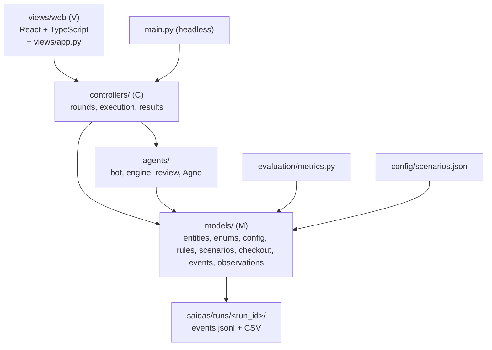

# Architecture Decision Records (ADRs) — Trabalho 2

Este diretório registra as decisões de arquitetura e tecnologia do simulador adversarial do **PedeJá** (`trabalho-2`).
Cada ADR descreve o contexto, a decisão, as alternativas descartadas e as consequências, para que a escolha possa ser
defendida na apresentação e revisada depois.

## Como ler

- **Status:** `Proposta` (em discussão), `Aceita` (vale para o código), `Depreciada` (não vale mais) ou
  `Substituída por ADR-XXX`.
- **Uma decisão por ADR.** Se uma decisão mudar, cria-se uma nova ADR e marca-se a antiga como substituída; o histórico
  não é reescrito.
- **Rastreabilidade:** cada ADR referencia os requisitos do `Enunciado.md` e as seções/IDs do `Trabalho1.md` (`A1/A2`,
  `B1/B2`, `P1–P3`, `PE1–PE3`, `AM1–AM3`).
- **Execução:** as Issues de implementação ficam em [`../issues/README.md`](../issues/README.md); cada uma aponta as
  ADRs
  que executa e os critérios de aceite.

## Visão geral



A view não importa `models/` nem `agents/`: recebe dados prontos do controller. `evaluation/` é o único consumidor dos
rótulos e do mapa pessoa↔conta. Enquanto o backend está em esqueleto, o frontend consome uma fonte sintética atrás da
interface `SimulatorSource` (ADR-014).

## Estrutura de módulos (MVC simples)

A organização segue as ADR-010 e ADR-011: `models/` (M), `views/` (V) e `controllers/` (C). `agents/` e `evaluation/`
ficam
fora do MVC porque são, respectivamente, atores de domínio e avaliador isolado. A árvore mantém o protótipo enxuto, mas
separa as responsabilidades que vão crescer (regras puras, páginas e componentes).

```text
trabalho-2/
├── main.py                         # entrypoint headless (ADR-013)
├── config/scenarios.json
├── docs/adr/
├── saidas/                         # runs/<run_id>/ com events.jsonl e CSV, ignorados pelo git
├── src/                            # raiz dos pacotes de topo
│   ├── models/                     # M — estado, regras e simulação
│   │   ├── entities.py
│   │   ├── enums.py
│   │   ├── config.py
│   │   ├── scenarios.py
│   │   ├── checkout.py
│   │   ├── events.py
│   │   ├── observations.py
│   │   └── rules/
│   │       ├── coupon.py
│   │       └── relations.py
│   ├── agents/                     # atores do domínio (Agno)
│   │   ├── bot.py
│   │   ├── engine.py
│   │   ├── review.py
│   │   ├── agno_adapter.py
│   │   ├── policies.py
│   │   └── tactics.py
│   ├── controllers/                # C — orquestração
│   │   ├── rounds.py
│   │   ├── execution.py
│   │   └── results.py
│   ├── views/                      # V — React + TypeScript
│   │   ├── app.py                  # serve views/web/dist
│   │   └── web/
│   │       ├── package.json
│   │       ├── index.html
│   │       └── src/
│   │           ├── app/
│   │           ├── components/
│   │           ├── data/
│   │           └── pages/
│   └── evaluation/
│       └── metrics.py
└── tests/
```

O caminho padrão é o **modo determinístico**. O modo `adversarial_validation` troca apenas o modelo do bot pelo LLM
externo; o motor e o executor continuam iguais. O protocolo da rodada está na ADR-011. A demonstração roda por
`uv run trabalho-2`, que serve o build React, ou por `python main.py` (ADR-013); os dois caminhos usam o mesmo caso de
uso do controller e gravam a mesma evidência em `saidas/runs/<run_id>/` (ADR-005).

## Índice

| ADR                                                         | Decisão                                                                           | Status                    |
|-------------------------------------------------------------|-----------------------------------------------------------------------------------|---------------------------|
| [ADR-001](ADR-001-linguagem-ambiente-e-layout.md)           | Python 3.12, `uv` e layout `src`; sem `pedeja-simulador/` nem `requirements.txt`  | Aceita                    |
| [ADR-002](ADR-002-agno-como-harness-dos-agentes.md)         | Agno como harness dos dois agentes; motor determinístico e bot plugável           | Aceita                    |
| [ADR-003](ADR-003-llm-adversario-no-nivel-da-tatica.md)     | LLM adversário no nível da tática, com catálogo fechado e executor determinístico | Aceita                    |
| [ADR-004](ADR-004-simulador-de-rodadas-sincrono.md)         | Simulador síncrono de rodadas com relógio virtual, sem discrete-event             | Aceita                    |
| [ADR-005](ADR-005-estado-em-memoria-e-configuracao-json.md) | Estado em memória, configuração em JSON; `events.jsonl` canônico e CSV derivado   | Aceita (emenda 20/11)     |
| [ADR-006](ADR-006-separacao-de-informacao.md)               | Separação de informação por projeções, DTOs e ferramentas escopadas               | Aceita                    |
| [ADR-007](ADR-007-reprodutibilidade-e-replay.md)            | RNG independente por ator, seeds versionadas e replay do transcript               | Aceita                    |
| [ADR-008](ADR-008-interface-streamlit.md)                   | Streamlit em página única, execução in-process                                    | Substituída pela ADR-014  |
| [ADR-009](ADR-009-estrategia-de-testes.md)                  | pytest, sem rede na suíte padrão; LLM marcado e pulado sem chave                  | Aceita                    |
| [ADR-010](ADR-010-organizacao-mvc.md)                       | MVC simples; agentes e avaliador fora do MVC; mapa do Plano de Tarefas por módulo | Aceita (emenda 20/11)     |
| [ADR-011](ADR-011-iteracao-adversarial.md)                  | Protocolo da rodada, projeções e gatilhos; 5–6 rodadas como cenário de referência | Aceita (atualizada 20/11) |
| [ADR-012](ADR-012-economia-do-atacante.md)                  | Economia do atacante: orçamento, custo por tática e recuo por ROI                 | Aceita                    |
| [ADR-013](ADR-013-execucao-headless.md)                     | `main.py` headless, com a mesma evidência da interface                            | Aceita                    |
| [ADR-014](ADR-014-frontend-react-typescript.md)             | Frontend React/TypeScript em `src/views/web/`; build servido por `views/app.py`   | Aceita                    |

## Mapa de rastreabilidade

| Requisito ou restrição                                            | Onde é atendido           |
|-------------------------------------------------------------------|---------------------------|
| Escopo delimitado (Enunciado, req. 1)                             | ADR-002, ADR-004          |
| Dois agentes, objetivos conflitantes e regras explícitas (req. 2) | ADR-002, ADR-003          |
| Três rodadas conectadas (req. 3)                                  | ADR-004, ADR-011          |
| Adaptação por observação (req. 4)                                 | ADR-003, ADR-004, ADR-011 |
| Iteração adversarial (protocolo da rodada)                        | ADR-011                   |
| Evidências e registro (req. 5)                                    | ADR-005, ADR-006, ADR-007 |
| Agno na camada de agentes (`AGENTS.md`)                           | ADR-002                   |
| `agents/` e `models/checkout.py` não importam `evaluation/`       | ADR-006, ADR-009          |
| Organização de pastas (MVC simples)                               | ADR-010                   |
| Quatro controles da AM3 (Trabalho 1, §4.5 e §5.2)                 | ADR-003, ADR-006, ADR-009 |
| Configuração e sementes registradas (§6.4)                        | ADR-005, ADR-007          |
| Interface web e CSV (§6.2 e §6.4)                                 | ADR-005, ADR-014          |
| Cinco a seis rodadas no cenário de referência (plano)             | ADR-011                   |
| Recuo do bot por custo por aprovação e ROI (plano)                | ADR-012                   |
| `main.py` e histórico da simulação (plano)                        | ADR-005, ADR-013          |
| Divisão de trabalho por integrante (plano)                        | ADR-010                   |

## Conflitos registrados

1. **§6.1 do Trabalho 1 × `AGENTS.md`.** O relatório diz "sem modelos de IA"; o `AGENTS.md` exige Agno, e o grupo
   decidiu usar um LLM externo como bot atacante. A ADR-002 resolve separando harness (Agno), decisão (política) e
   estado (simulador); a ADR-003 restringe o LLM a um catálogo fechado de táticas. O `AGENTS.md` ainda declara "no
   external services or hidden model calls" e **deve ser atualizado** para refletir o modo opcional.
2. **§6.4 × repositório uv.** A estrutura `pedeja-simulador/` + `requirements.txt` é anterior ao `pyproject.toml`. A
   ADR-001 registra a adaptação, conforme o próprio `AGENTS.md`.
3. **Python 3.14 × Agno.** O Agno não certifica 3.14; a ADR-001 desce para 3.12. O `uv sync` confirmou a resolução em
   Python 3.12.16.
4. **Plano de Tarefas do Grupo 9 × ADR-010.** O plano divide o trabalho por arquivo de topo (`src/ambiente.py`,
   `src/agente_bot.py`, `src/adaptacao_bot.py`, `src/evidencias.py`) e nomeia classes e métodos em português. Isso é o
   "pacote plano" rejeitado na ADR-010 e contraria o `AGENTS.md` §5. A emenda da ADR-010 resolve com um **mapa de
   entregáveis → módulos**: a propriedade individual é preservada, o layout não muda e o código continua em inglês.
5. **Plano de Tarefas × Enunciado.** O plano descreve uma sequência fixa de rodadas (R1 A2+B1 → R2 B2 → R3 SMS/CPF →
   R4/R5 recuo por ROI). O `Enunciado.md` rejeita "sequência previamente roteirizada". A ADR-011 trata a trajetória como
   **hipótese do cenário de referência**; ela só se realiza se os gatilhos dispararem.
6. **Plano de Tarefas × ADR-005.** O plano pede `logs/historico_simulacao.json`; a ADR-005 fixa `saidas/` e CSV. A
   emenda
   da ADR-005 adota `saidas/runs/<run_id>/events.jsonl` como fonte canônica, com CSV derivado, e dispensa a pasta
   `logs/`.
7. **`AGENTS.md` §4/§5 × frontend dedicado.** O `AGENTS.md` ainda cita `streamlit run app.py` e as páginas Python em
   `views/pages/`. A ADR-014 substitui a view pelo app React/TypeScript em `src/views/web/` e mantém `views/app.py`
   apenas como servidor do build. O restante do MVC e a separação de informação não mudam.

## Estado do ambiente

- Python **3.12.16**, `agno==3.1.7`, `pandas==3.1.1` e `pytest==9.2.0` via `uv`; `streamlit` foi removido na ADR-014.
- Node 22 e npm 10 para o frontend em `src/views/web/` (React 19, Vite 7, Tailwind 4).
- `uv sync`, `uv run trabalho-2` e `npm --prefix src/views/web run build` funcionam. `src/views/app.py` serve o build
  estático; as cinco telas estão implementadas com dados sintéticos determinísticos.
- As ADR-012 e ADR-013 foram criadas e as ADR-005, 010, 011 e 014 emendadas/registradas em 20/11/2026. O backend Python
  (`models/`, `agents/`, `controllers/`, `evaluation/`) continua em esqueleto.

## Decisões em aberto

- Escolher o provedor padrão (Anthropic ou Groq) quando a chave existir; o código fica agnóstico ao provedor (ADR-003).
- Calibrar o catálogo de táticas, os gatilhos de adaptação e os limiares da AM3 com os cenários sintéticos (ADR-003,
  ADR-009, ADR-011).
- **Reconciliar o custo da tática de emulador:** R$ 12 por conta (plano) × R$ 8 na rodada de sondagem (Trabalho 1 §3).
  Definir se os R$ 8 são custo incremental ou insumo já comprado (ADR-012).
- Definir a `safety_margin` do recuo e se o bot pode voltar de A1 para A2 depois de pausar (ADR-012).
- Fixar quantas rodadas a suíte padrão executa (3) e quantas o cenário de demonstração executa (6), no
  `config/scenarios.json` (ADR-011).
- Atualizar o `AGENTS.md` para registrar que o LLM é opcional, que os testes nunca o exigem e que `main.py` é o
  entrypoint headless (§3, §7 e ADR-013).

## Como adicionar uma ADR

1. Copie a estrutura de uma ADR existente (`Status`, `Contexto`, `Decisão`, `Consequências`, `Alternativas`,
   `Referências`).
2. Numere em sequência e use um nome descritivo em kebab-case.
3. Se a decisão substituir outra, marque a antiga como `Substituída por ADR-XXX` e explique o motivo na nova.
4. Atualize a tabela do índice e o mapa de rastreabilidade.
